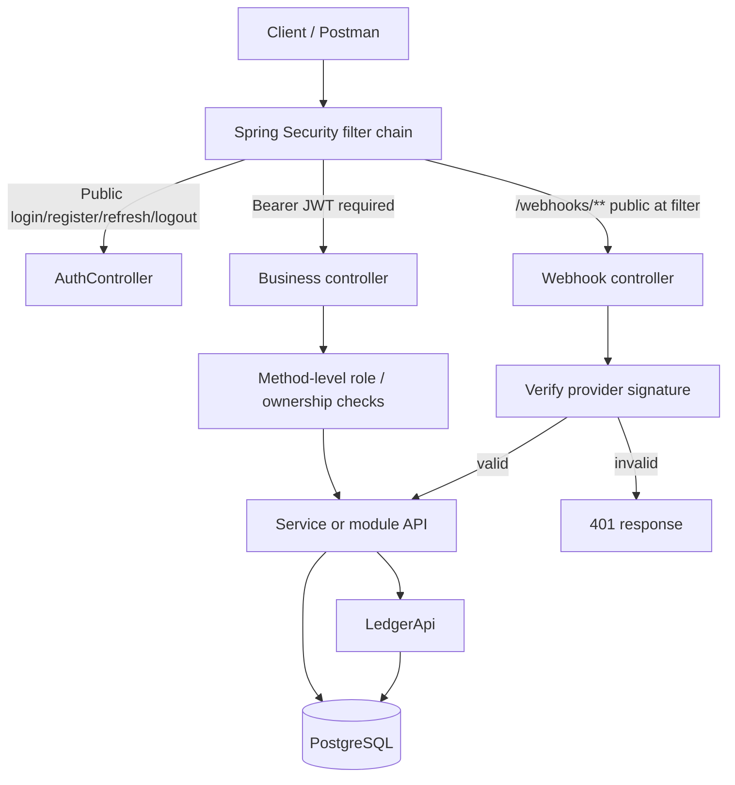
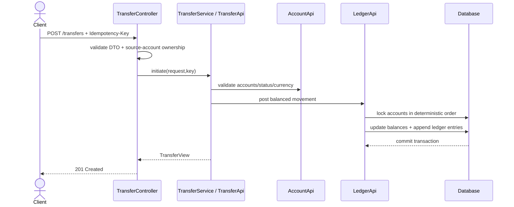
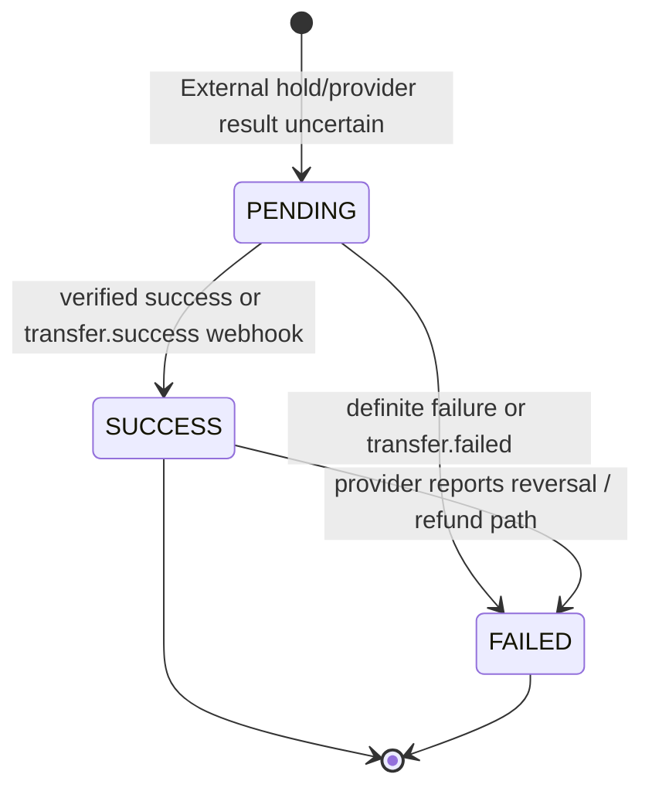
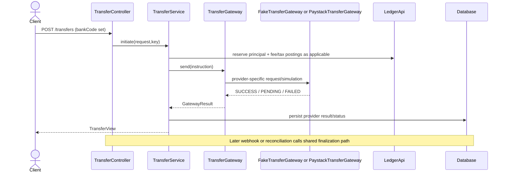
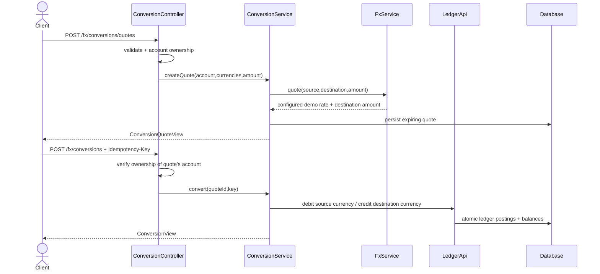
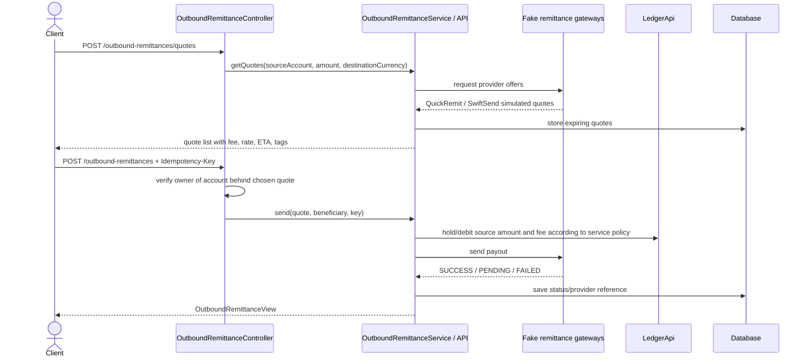
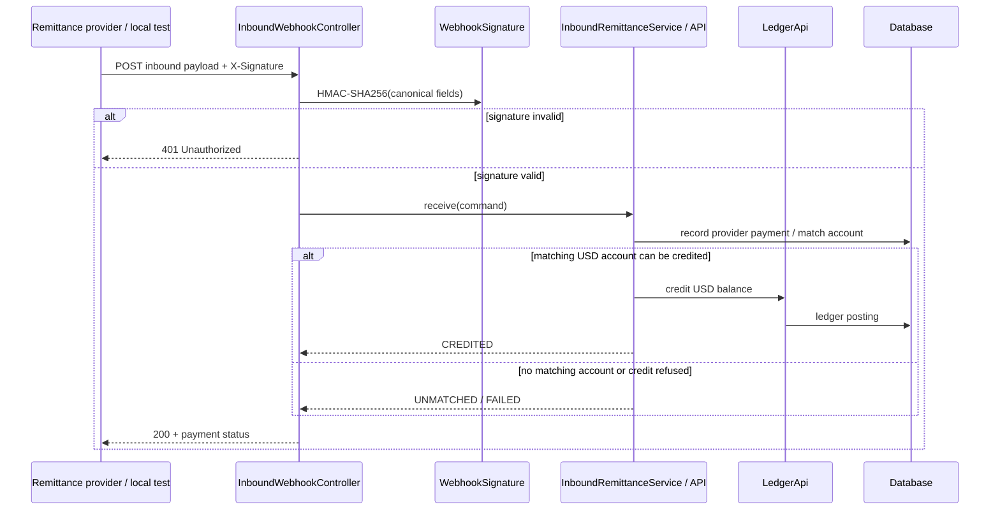
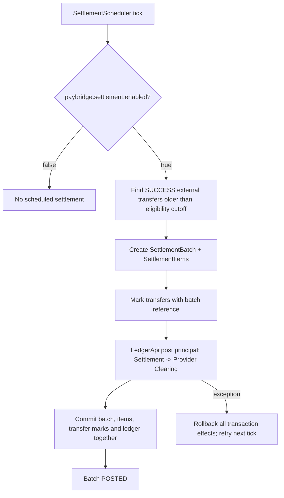
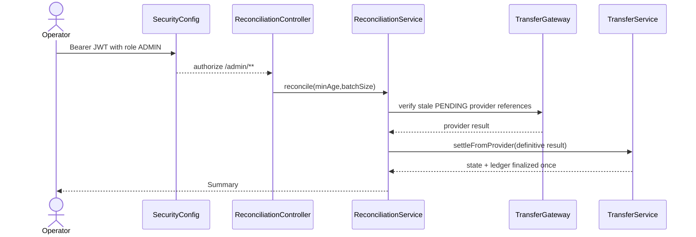

# PayBridge API Flow Guide

This guide follows the implementation in the uploaded working-tree snapshot. The application is a modular monolith: one Spring Boot process and relational database, with module APIs separating account, ledger, transfer, FX, remittance, and settlement responsibilities.

## 1. Request/security boundary



`SecurityConfig` is stateless and validates bearer JWTs. The JWT `role` claim becomes `ROLE_CUSTOMER` or `ROLE_ADMIN`. Filter-level access decides whether a route is public, signed-in, or admin-only; method-level `@PreAuthorize`/`@PostAuthorize` and `AccountAccessGuard` enforce account ownership. The current `RoleAccessTest` enumerates all 33 business routes and checks that each route has an access decision.

## 2. Registration, login, refresh

Start: `POST /auth/register`, then `POST /auth/login`.

```mermaid
sequenceDiagram
    actor Client
    participant AC as AuthController
    participant AS as AuthService
    participant UR as AppUserRepository
    participant AA as AccountApi
    participant AT as RefreshTokenService
    Client->>AC: POST /auth/register
    AC->>AS: register(email,password,fullName)
    AS->>UR: save CUSTOMER identity
    AS->>AA: open(customerId, fullName)
    Note over AA: Creates NGN + USD balances under one account number
    AS-->>AC: UserView (no tokens)
    AC-->>Client: 201 Created
    Client->>AC: POST /auth/login
    AC->>AS: validate password
    AS->>AT: startSession(userId)
    AT-->>AS: raw refresh token; hashed token persisted
    AS-->>AC: access JWT + refresh token + UserView
    AC-->>Client: 200 TokenResponse
```

Refresh starts at `POST /auth/refresh`. A valid refresh token is marked used and replaced with a new token in the same family. Reuse of an already-used token revokes that family; clients must persist the newly returned refresh token after every refresh. `/auth/logout` revokes a token family; `/auth/logout-all` revokes all refresh families for the authenticated user.

## 3. Internal transfer

Start: `POST /transfers` without `bankCode`.



Money is in minor units. The ledger is responsible for locking and posting debit/credit entries. The intended transaction boundary prevents only one side of an internal transfer from committing. The exact idempotency replay response is service-defined; retry the same business request with the same key and inspect reference/ledger rows rather than assuming every endpoint returns identical bytes.

## 4. External transfer, webhook, reconciliation

Start: `POST /transfers` with `bankCode`.





- Fake provider is selected when profile `paystack` is **not** active. Paystack profile selection is not automatic fallback.
- Paystack webhook `POST /webhooks/paystack` validates HMAC-SHA512 of the raw request bytes using `paystack.secret-key` before parsing events.
- The reconciliation route `POST /admin/reconciliation/run` is ADMIN-only. A separate scheduler is enabled by default unless explicitly disabled.
- `SUCCESS` in PayBridge is the provider outcome represented by the configured gateway; fake `SUCCESS` is not proof that an actual bank payout occurred.
- Do not refund an unknown/pending outcome merely because a network call timed out. Reconcile the provider first to avoid double payment.

## 5. FX quote and conversion

Start: `GET /fx/quote` for an immediate indicative configured quote, or `POST /fx/conversions/quotes` for a stored account-specific quote followed by `POST /fx/conversions`.



Rates default to NGN→USD `0.00065` and USD→NGN `1500`, but can be overridden. They are configured demo rates, not live provider market rates. Output `rateType` explicitly identifies demo configuration. NGN and USD balances share an account number but are distinct currency rows.

## 6. Outbound remittance

Start: `POST /outbound-remittances/quotes`, select one quote, then `POST /outbound-remittances`.



Statuses: `PENDING` means the funds are held while provider outcome is unresolved; `COMPLETED` means provider reported payout success; `FAILED` means definite non-send and funds returned; `RETURNED` means a previously completed payout later came back and the amount was refunded. Manual `POST /outbound-remittances/{reference}/reconcile` is ADMIN-only, and an automatic reconciler polls pending payouts when enabled. Current provider implementations are fakes, so do not represent these as real international transfers.

## 7. Inbound remittance and payment matching

Start: provider calls `POST /webhooks/remittance/inbound`.



Canonical signature for inbound credit: `providerReference|accountNumber|amountMinor|currency`, HMAC-SHA256 hex. The inbound handler deliberately acknowledges unmatched payments with HTTP 200 so providers do not retry a payment that needs operator intervention. `GET /inbound-payments` and detail are ADMIN-only.

Reversal webhook `POST /webhooks/remittance/inbound/reversal` signs `reversal|providerReference`. It tries to take the inbound amount back from the USD balance. If the customer already spent or converted the funds, status can be `REVERSAL_FAILED`; this is an exception requiring an operator, not proof that the provider chargeback disappeared.

## 8. Outbound return webhook

Start: `POST /webhooks/remittance/outbound/returned`.

```mermaid
flowchart TD
    P[Provider reports returned payout] --> WH[InboundWebhookController]
    WH --> SIG[Verify HMAC-SHA256 of returned|reference]
    SIG -->|invalid| U[401]
    SIG -->|valid| API[OutboundRemittanceApi.markReturned]
    API --> CHECK[Find outbound reference and current status]
    CHECK --> REFUND[Refund amount once under service rules]
    REFUND --> RETURNED[Status RETURNED + reason]
```

This signature uses PayBridge's outbound reference, not the provider reference. The service should not double-refund repeated provider reports; confirm behavior through `RemittanceReversalTest`/the returned-webhook tests before changing it.

## 9. Settlement batches

There is no manual HTTP endpoint in the current route inventory. `SettlementScheduler` calls `SettlementApi.settleNextBatch` when enabled.



The snapshot's `application.yml` sets `paybridge.settlement.enabled: false`, so scheduled settlement is disabled by default in that configuration. If enabled, the scheduler processes NGN only, defaults to six-hour eligibility age and batch size 50. Fees/taxes were posted in the external transfer lifecycle; settlement moves eligible principal from the PayBridge Settlement system account to Provider Clearing. This is PayBridge's internal clearing ledger movement, not evidence that the provider bank balance was reconciled or funds physically settled.

## 10. Admin reconciliation and security

Start: `POST /admin/reconciliation/run?minAgeSeconds=0&batchSize=50`.



Anonymous requests should get 401; a CUSTOMER token should get 403. Account opening/status changes and inbound/outbound operator lists are also ADMIN-only by `SecurityConfig` and `RoleAccessTest`. Other signed-in routes are not automatically admin-only; account-specific routes also use owner checks. Public webhook routes are authenticated by their HMAC signatures instead of bearer JWTs.

## 11. Important statuses and test coverage

| Flow | Statuses found in source | Meaning worth remembering |
|---|---|---|
| Transfer | `PENDING`, `SUCCESS`, `FAILED` | `PENDING` is unresolved; provider reversal maps into shared finalization/failure path |
| FX conversion | `PENDING`, `COMPLETED`, `FAILED` | Conversion is a ledger operation at a stored quote |
| Direct remittance | `PENDING`, `COMPLETED`, `FAILED` | Do not assume direct route is equivalent to provider comparison/send |
| Outbound remittance | `PENDING`, `COMPLETED`, `FAILED`, `RETURNED` | Return after completion can cause a refund |
| Inbound payment | `RECEIVED`, `CREDITED`, `UNMATCHED`, `FAILED`, `REVERSED`, `REVERSAL_FAILED` | Unmatched or failed reversal requires operator attention |
| Settlement batch | `BatchStatus` enum | Batch/item state is internal; no route is exposed |

Tests relevant to these paths include `RoleAccessTest`, `OwnershipTest`, `AuthRefreshTest`, `TransferServiceTest`, `TransferSettlementTest`, `ReconciliationTest`, `ConversionServiceTest`, `OutboundRemittanceTest`, `InboundWebhookTest`, `ReversalWebhookTest`, `RemittanceReversalTest`, and `SettlementServiceTest`. This guide did not execute the test suite; the names and route/security assertions were inspected in source. Run tests locally before treating the documentation as runtime certification.
